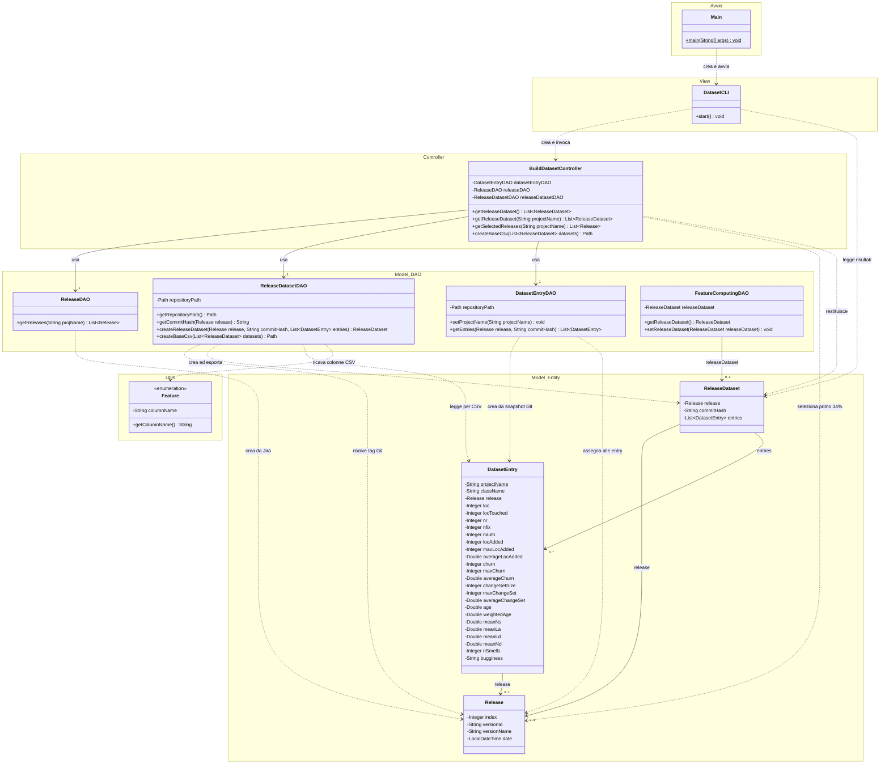

# Dataset Builder — Class diagram MVC

Diagramma ricostruito dal codice Java attuale. Sono riportati gli attributi e i metodi principali; costruttori, getter/setter delle entità e metodi privati di supporto sono omessi.

## Responsabilità MVC

| Livello | Classi | Responsabilità |
| --- | --- | --- |
| View | `DatasetCLI` | Gestisce menu, input, messaggi, errori e visualizzazione del risultato. |
| Controller | `BuildDatasetController` | Coordina i DAO, seleziona il primo 34% delle release e avvia la costruzione/esportazione del dataset. |
| Model — DAO | `ReleaseDAO`, `ReleaseDatasetDAO`, `DatasetEntryDAO` | Recuperano release da Jira, commit e percorsi Java da Git e scrivono il CSV. |
| Model — entità | `Release`, `ReleaseDataset`, `DatasetEntry` | Rappresentano release, snapshot del dataset e righe con metriche. |
| Model — DAO non integrato | `FeatureComputingDAO` | Attualmente espone solo getter/setter di un dataset; non calcola feature e non è richiamato dal flusso MVC. |
| Supporto | `Main`, `Feature` | Avvio dell'applicazione e definizione dei nomi delle colonne. |

## Lettura delle relazioni

- Le frecce tratteggiate indicano dipendenze: creazione, invocazione o uso temporaneo di oggetti.
- Le frecce continue indicano riferimenti conservati negli attributi. Non viene usata la composizione perché il codice non impone proprietà esclusiva o gestione del ciclo di vita delle entità.
- `0..1` riflette i riferimenti alle entità inizialmente null e assegnabili tramite setter. Nel flusso di costruzione completato ogni dataset e ogni entry ricevono una release.
- `projectName` è statico: è condiviso da tutte le istanze di `DatasetEntry`.
- La View legge le entità per contare le entry; i dati vengono quindi restituiti alla View tramite il Controller, senza un meccanismo di notifica/Observer.
- Il CSV attuale contiene le colonne delle feature, ma i relativi valori sono ancora vuoti.
