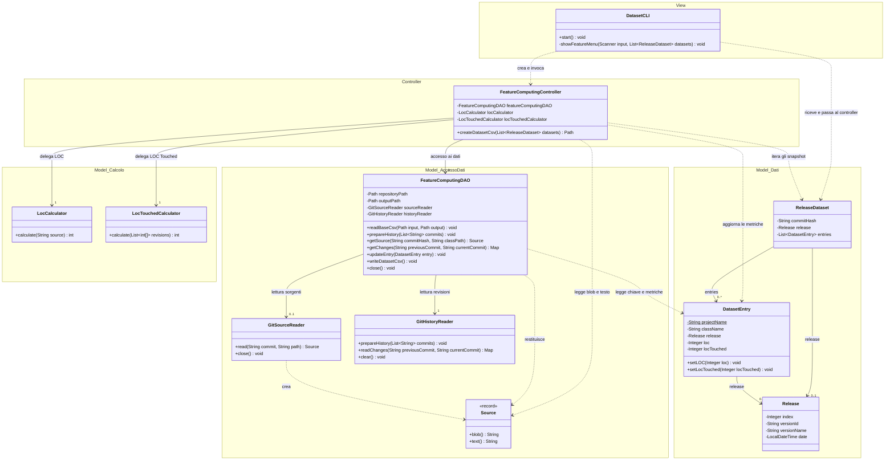

# UC2 — Calcolo delle feature: class diagram MVC

Il secondo caso d'uso è identificato con il comando «Crea Dataset.csv con le feature calcolate» di `DatasetCLI`. Il diagramma descrive il codice attuale, con LOC e LOC Touched implementate. Precondizioni: CSV di base già creato e lista dei `ReleaseDataset` disponibile, completa dall'inizio del dataset e ordinata per release.

I raggruppamenti rappresentano responsabilità architetturali, non nuovi package Java: `metrics` appartiene logicamente al Model, mentre i lettori Git si trovano nel package `utils`.

## Responsabilità MVC

| Livello | Classi | Responsabilità nel caso d'uso |
| --- | --- | --- |
| View | `DatasetCLI` | Mostra il menu, legge la scelta, invoca il controller e mostra il percorso prodotto o l'errore. |
| Controller | `FeatureComputingController` | Coordina copia/lettura del CSV, preparazione della storia, iterazione delle release e delle entry, calcolo delle metriche e salvataggio. Gestisce anche la cache LOC per blob. |
| Model: dati | `ReleaseDataset`, `DatasetEntry`, `Release` | Rappresentano snapshot, righe del dataset e release. `DatasetEntry` conserva i risultati delle metriche. |
| Model: calcolo | `LocCalculator`, `LocTouchedCalculator` | Implementano gli algoritmi senza dipendere da View o Controller. LOC analizza il testo; LOC Touched somma aggiunte e cancellazioni. |
| Model: accesso ai dati | `FeatureComputingDAO`, `GitSourceReader`, `GitHistoryReader`, `GitSourceReader.Source` | Gestiscono CSV, sorgenti e cronologia Git. Il DAO mantiene in memoria righe e indici del CSV; i lettori recuperano i dati Git. |

Il punto centrale dell'MVC è la separazione delle responsabilità: **la View interagisce con l'utente, il Controller coordina il caso d'uso e il Model gestisce dati, algoritmi e accesso alle risorse**. Il Model non conosce né CLI né controller. La View conosce `ReleaseDataset`, perché passa al controller i risultati ottenuti nel primo caso d'uso; questo non introduce accesso diretto ai DAO.

Non è presente un meccanismo Observer: l'interazione è sincrona. `createDatasetCsv` restituisce un `Path`, mentre gli errori risalgono alla CLI, che li mostra all'utente.

## Svolgimento del caso d'uso

1. La CLI riceve la richiesta e passa i dataset al `FeatureComputingController`.
2. Il controller chiede al DAO di copiare `output/dataset_base.csv` in `output/Dataset.csv`, leggere la copia e preparare la cronologia Git.
3. Per ogni release recupera le modifiche rispetto alla precedente; per la prima considera la storia raggiungibile dal suo commit.
4. Per ogni entry legge il sorgente, delega il calcolo ai due calcolatori e aggiorna l'entità tramite i setter. Il calcolo LOC è riutilizzato per blob già incontrati.
5. Il DAO trasferisce LOC e LOC Touched nelle celle della riga identificata da progetto, percorso della classe e release.
6. Il DAO scrive il CSV; il controller chiude le risorse e restituisce il percorso alla CLI.

## Convenzioni e dettagli omessi

- Freccia tratteggiata: dipendenza temporanea. Freccia continua: riferimento mantenuto in un attributo. Le frecce del class diagram non indicano l'ordine temporale delle chiamate.
- Le molteplicità `0..1` delle release riflettono campi nullable nel codice; nel flusso ordinario i riferimenti sono valorizzati. `sourceReader` è creato alla prima lettura e azzerato alla chiusura.
- Non si introduce composizione per le entità: i setter non impongono proprietà esclusiva.
- `projectName` è statico, come nell'implementazione attuale.
- `Source` è il record annidato `GitSourceReader.Source`. Il tipo abbreviato `Map` nei metodi della cronologia è `Map<String, List<int[]>>`: ogni coppia contiene aggiunte e cancellazioni.
- Per leggibilità sono omessi costruttori, getter/setter non essenziali, altre metriche dell'entry, indici interni del DAO, `EntryKey`, helper `CsvFormat`, enum `Feature` e realizzazione dell'interfaccia `AutoCloseable` da parte del DAO e di `GitSourceReader`.
- Il campo `releaseDataset` del DAO e i suoi accessori esistono ma non partecipano a questo flusso, quindi sono omessi.
- `BuildDatasetController` appartiene al primo caso d'uso, che fornisce le precondizioni del secondo.

Questo è un diagramma dell'implementazione esistente. Un eventuale servizio di elaborazione nel Model potrebbe in futuro assorbire ciclo e cache del controller; tale classe oggi non esiste e non è introdotta nel diagramma.
