# UC2 — Calcolo delle feature: class diagram MVC

Il secondo caso d'uso è identificato con il comando «Crea Dataset.csv con le feature calcolate» di `DatasetCLI`. Il diagramma descrive il codice attuale, con LOC, LOC Touched, NR, Nfix, Nauth, LOC Added, Max LOC Added e WMC implementate. Precondizioni: CSV di base già creato e lista dei `ReleaseDataset` disponibile, completa dall'inizio del dataset e ordinata per release.

I raggruppamenti rappresentano responsabilità architetturali, non nuovi package Java: `metrics` appartiene logicamente al Model, mentre i lettori Git si trovano nel package `utils`.

```mermaid
classDiagram
direction TB

namespace View {
    class DatasetCLI {
        +start() void
        -showFeatureMenu(Scanner input, List~ReleaseDataset~ datasets) void
    }
}

namespace Controller {
    class FeatureComputingController {
        -FeatureComputingDAO featureComputingDAO
        -WmcCalculator wmcCalculator
        -LocCalculator locCalculator
        -LocTouchedCalculator locTouchedCalculator
        -NrCalculator nrCalculator
        -NfixCalculator nfixCalculator
        -NauthCalculator nauthCalculator
        +createDatasetCsv(List~ReleaseDataset~ datasets) Path
    }
}

namespace Model_Calcolo {
    class WmcCalculator {
        +calculate(String source) int
    }
    class LocCalculator {
        +calculate(String source) int
    }
    class NauthCalculator {
        +calculate(List~String~ authorEmails) int
    }
    class NfixCalculator {
        +calculate(Map~String,String~ messagesByCommit, Set~String~ fixedBugKeys) int
    }
    class NrCalculator {
        +calculate(List~Revision~ revisions) int
    }
    class LocTouchedCalculator {
        +calculate(List~Revision~ revisions) int
    }
}

namespace Model_Dati {
    class ReleaseDataset {
        -String commitHash
        -Release release
        -List~DatasetEntry~ entries
    }
    class DatasetEntry {
        -String projectName$
        -String className
        -Release release
        -Integer loc
        -Integer locTouched
        -Integer nr
        -Integer nfix
        -Integer nauth
        +setLOC(Integer loc) void
        +setLocTouched(Integer locTouched) void
        +setNr(Integer nr) void
        +setNfix(Integer nfix) void
        +setNauth(Integer nauth) void
    }
    class Release {
        -Integer index
        -String versionId
        -String versionName
        -LocalDateTime date
    }
}

namespace Model_AccessoDati {
    class Revision {
        <<record>>
        +String commitHash
        +String message
        +String authorEmail
        +int added
        +int deleted
    }
    class FeatureComputingDAO {
        +getTicketIDs(String projName) List~String~
        -Path repositoryPath
        -Path outputPath
        -GitSourceReader sourceReader
        -GitHistoryReader historyReader
        +readBaseCsv(Path input, Path output) void
        +prepareHistory(List~String~ commits) void
        +getSource(String commitHash, String classPath) Source
        +getChanges(String previousCommit, String currentCommit) Map
        +updateEntry(DatasetEntry entry) void
        +writeDatasetCsv() void
        +close() void
    }
    class GitSourceReader {
        +read(String commit, String path) Source
        +close() void
    }
    class Source {
        <<record>>
        +blob() String
        +text() String
    }
    class GitHistoryReader {
        +prepareHistory(List~String~ commits) void
        +readChanges(String previousCommit, String currentCommit) Map
        +clear() void
    }
}

DatasetCLI ..> FeatureComputingController : crea e invoca
DatasetCLI ..> ReleaseDataset : riceve e passa al controller
FeatureComputingController --> "1" FeatureComputingDAO : accesso ai dati
FeatureComputingController --> "1" LocCalculator : delega LOC
FeatureComputingController --> "1" WmcCalculator : delega WMC
FeatureComputingController --> "1" LocTouchedCalculator : delega LOC Touched
FeatureComputingController --> "1" NrCalculator : delega NR
FeatureComputingController --> "1" NfixCalculator : delega Nfix
FeatureComputingController --> "1" NauthCalculator : delega Nauth
GitHistoryReader ..> Revision : crea
FeatureComputingController ..> ReleaseDataset : itera gli snapshot
FeatureComputingController ..> DatasetEntry : aggiorna le metriche
FeatureComputingController ..> Source : legge blob e testo
ReleaseDataset --> "0..*" DatasetEntry : entries
ReleaseDataset --> "0..1" Release : release
DatasetEntry --> "0..1" Release : release
FeatureComputingDAO --> "0..1" GitSourceReader : lettura sorgenti
FeatureComputingDAO --> "1" GitHistoryReader : lettura revisioni
FeatureComputingDAO ..> DatasetEntry : legge chiave e metriche
FeatureComputingDAO ..> Source : restituisce
GitSourceReader ..> Source : crea
```

## Responsabilità MVC

| Livello | Classi | Responsabilità nel caso d'uso |
| --- | --- | --- |
| View | `DatasetCLI` | Mostra il menu, legge la scelta, invoca il controller e mostra il percorso prodotto o l'errore. |
| Controller | `FeatureComputingController` | Coordina copia/lettura del CSV, preparazione della storia, iterazione delle release e delle entry, calcolo delle metriche e salvataggio. Gestisce anche la cache LOC per blob. |
| Model: dati | `ReleaseDataset`, `DatasetEntry`, `Release` | Rappresentano snapshot, righe del dataset e release. `DatasetEntry` conserva i risultati delle metriche. |
| Model: calcolo | `LocCalculator`, `LocTouchedCalculator`, `NrCalculator`, `NfixCalculator`, `NauthCalculator`, `WmcCalculator` | Implementano gli algoritmi senza dipendere da View o Controller. LOC analizza il testo; LOC Touched somma aggiunte e cancellazioni; NR conta le revisioni distinte, incluse quelle a zero righe. Nfix conta i commit collegati agli ID dei bug. |
| Model: accesso ai dati | `FeatureComputingDAO`, `GitSourceReader`, `GitHistoryReader`, `GitSourceReader.Source`, `GitHistoryReader.Revision` | Gestiscono ticket Jira, CSV, sorgenti e cronologia Git. Il DAO mantiene in memoria righe e indici del CSV; i lettori recuperano i dati Git. |

Il punto centrale dell'MVC è la separazione delle responsabilità: **la View interagisce con l'utente, il Controller coordina il caso d'uso e il Model gestisce dati, algoritmi e accesso alle risorse**. Il Model non conosce né CLI né controller. La View conosce `ReleaseDataset`, perché passa al controller i risultati ottenuti nel primo caso d'uso; questo non introduce accesso diretto ai DAO.

Non è presente un meccanismo Observer: l'interazione è sincrona. `createDatasetCsv` restituisce un `Path`, mentre gli errori risalgono alla CLI, che li mostra all'utente.

## Svolgimento del caso d'uso

1. La CLI riceve la richiesta e passa i dataset al `FeatureComputingController`.
2. Il controller chiede al DAO di copiare e leggere il CSV di base, recupera una volta gli ID con `FeatureComputingDAO.getTicketIDs`, poi prepara la cronologia Git.
3. Per ogni release recupera le modifiche rispetto alla precedente; per la prima considera la storia raggiungibile dal suo commit.
4. Per ogni entry legge il sorgente, delega il calcolo ai cinque calcolatori e aggiorna l'entità tramite i setter. Il calcolo LOC è riutilizzato per blob già incontrati.
5. Il DAO trasferisce LOC, LOC Touched, NR, Nfix e Nauth nelle celle della riga identificata da progetto, percorso della classe e release.
6. Il DAO scrive il CSV; il controller chiude le risorse e restituisce il percorso alla CLI.

## Convenzioni e dettagli omessi

- Freccia tratteggiata: dipendenza temporanea. Freccia continua: riferimento mantenuto in un attributo. Le frecce del class diagram non indicano l'ordine temporale delle chiamate.
- Le molteplicità `0..1` delle release riflettono campi nullable nel codice; nel flusso ordinario i riferimenti sono valorizzati. `sourceReader` è creato alla prima lettura e azzerato alla chiusura.
- Non si introduce composizione per le entità: i setter non impongono proprietà esclusiva.
- `projectName` è statico, come nell'implementazione attuale.
- `Source` è il record annidato `GitSourceReader.Source`. Il tipo abbreviato `Map` nei metodi della cronologia è `Map<String, List<Revision>>`: ogni `Revision` contiene hash, messaggio completo, aggiunte e cancellazioni di un commit distinto, anche con zero righe. Il reader aggrega eventuali percorsi distinti dello stesso commit; NR conta gli elementi, Nfix seleziona quelli collegati agli ID Jira.
- Per leggibilità sono omessi costruttori, getter/setter non essenziali, altre metriche dell'entry, indici interni del DAO, `EntryKey`, helper `CsvFormat`, enum `Feature` e realizzazione dell'interfaccia `AutoCloseable` da parte del DAO e di `GitSourceReader`.
- Il campo `releaseDataset` del DAO e i suoi accessori esistono ma non partecipano a questo flusso, quindi sono omessi.
- `BuildDatasetController` appartiene al primo caso d'uso, che fornisce le precondizioni del secondo.

Questo è un diagramma dell'implementazione esistente. Un eventuale servizio di elaborazione nel Model potrebbe in futuro assorbire ciclo e cache del controller; tale classe oggi non esiste e non è introdotta nel diagramma.

## Ticket e Nfix

Il metodo `FeatureComputingDAO.getTicketIDs` adatta lo script originale `Using Jira and Git/GetTicketsID/GetTicketID/src/main/java/RetrieveTicketsID.java`, come `ReleaseDAO` adatta lo script delle release: progetto parametrico e lista restituita al controller. Query, campi e paginazione originali rimangono invariati. Non viene introdotta un'entita Ticket, perche' per Nfix servono soltanto gli ID.

Il controller riceve dal DAO gli ID e le revisioni della classe nella release. Converte gli ID in un insieme ed estrae dalle revisioni una mappa `hash -> messaggio`, con una voce per commit, poi passa questi soli dati a `NfixCalculator`. Il calcolatore non dipende dal DAO, dal reader o dal tipo `Revision`. La lettura HTTP e' nel DAO; matching dei ticket e conteggio sono nel calcolatore. `FeatureComputingDAO` scrive Nfix dal campo gia' esistente nell'entry. `Revision` sostituisce le coppie di interi per conservare anche hash e messaggio, senza ulteriori scansioni Git. Gli errori Jira risalgono alla CLI: non vengono tradotti in zero fix.

`Revision` nel diagramma abbrevia `GitHistoryReader.Revision`: e' un record annidato nel reader, come `GitSourceReader.Source`. E' un contenitore tecnico immutabile dei dati Git, non una entity del dataset; le entity conservano i loro getter e setter.

Per Nauth, `GitHistoryReader` legge l'email Author nello stesso log Git e la conserva in `Revision.authorEmail`. Il DAO restituisce le revisioni al controller, che estrae una `List<String>` e la passa a `NauthCalculator`. Il calcolatore non dipende da DAO o reader; conta le email distinte normalizzate. Il DAO scrive `DatasetEntry.nauth` nella colonna `Nauth`.

WMC usa lo stesso sorgente Git di LOC e una cache per blob: il controller passa il testo a WmcCalculator e il DAO scrive DatasetEntry.wmc. Le regole di aggregazione per file e di conteggio sono descritte in feature-conventions.md.
